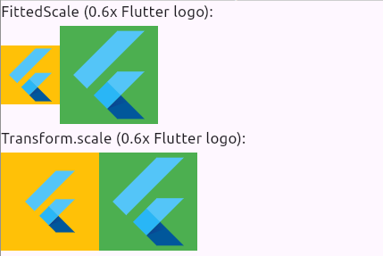
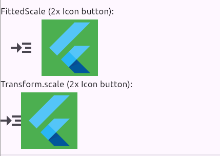
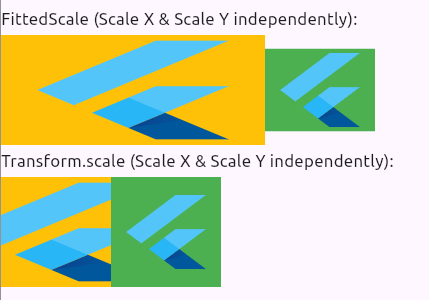

Fitted scale is a widget that scales its child prior to layout, the size of the final rendering box scales accordingly as the scaled child. Unlike `Transform.scale()`, which applies a transformaion just prior to painting, the redering box remains the same size. You may think of this as the scaling version of the `RotatedBox` widget.



## Usage

Scale your widget in a similar way as `Transform.scale()`

Apply a uniform scaling:

```dart
FittedScale(
  scale: 0.6,
  child: FlutterLogo( size: 110 )
),
```

Specify horizontal and/or vertical scaling independently:

```dart
FittedScale(
  scaleX: 0.6,
  scaleY: 1.3,
  child: FlutterLogo( size: 110 )
),
```

## More examples

This is an example of scaling up a material `IconButton`. The finally layout is more desirable compared to adopting `Transform.scale()`.

```dart
Row(children: [
  FittedScale(
    scale: 2.0,
    child: IconButton( onPressed: () {}, icon: Icon(Icons.read_more))),
  Container(
    color: Colors.green,
    child: FlutterLogo( size: 110 ),
  ),
])
```



Performing scaling prior to layout can sometimes avoid unwanted clipping.

```dart
Row(children: [
  Container(
    color: Colors.amber,
    child: FittedScale(
        scaleX: 2.4,
        child: FlutterLogo( size: 110 )),
  ),
  Container(
    color: Colors.green,
    child: FittedScale(
      scaleY: 0.75,
      child: FlutterLogo( size: 110 )),
  ),
]),
```



Notice that if the above is implemented with `Transform.scale()`, two sides of the Flutter logo(yellow background) are trimmed.

## Last but not least...

Please feel free to report any issues or suggest improvements [here](https://github.com/wahahachan/fitted_scale).
